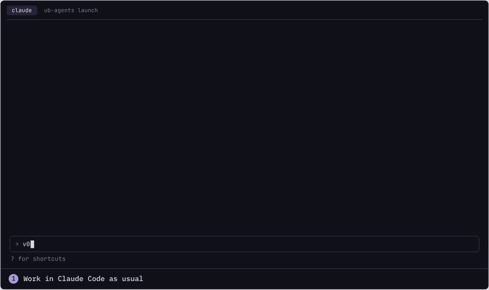

# ub-agents

ub-agents runs an implementation and review loop for your GitHub issues in the
background, on your own machine or server.

## Why this exists

We still work in Claude Code or Codex to decide what to build: we talk the
change through, settle the approach and agree on what done means. Once the work
is that clear, it doesn't need us sitting beside it, whether it's a bug, a
dependency update or a small fix. So we hand it to a background loop on a
machine we operate, and get back to deciding the next thing. The
[motivation page](https://agents.uberblick.ai/docs/motivation.html) has the
longer version.

The loop is deliberately small. GitHub holds the workflow state as labels and
comments, the roles and their instructions live in your repository, and there
is no separate orchestration server.

## How it works

1. **Work out the change** in Claude Code or Codex.
2. **Ask your agent to file the agreed work for the loop.** There's no special
   command: it opens a GitHub issue with `gh` and adds the label that starts the
   loop.
3. **Keep working.** Come back to review the result, or to answer a question
   when an agent needs a decision.



The animation is an example session from our website. Here is what really
happened to [#630](https://github.com/uberblick-ai/ub-agents/issues/630), the
issue it is based on. It was filed from a Claude Code session with
`needs-preparation`. The preparer checked it and marked it ready, and the
implementer opened
[#632](https://github.com/uberblick-ai/ub-agents/pull/632). The reviewer
[sent it back](https://github.com/uberblick-ai/ub-agents/pull/632#pullrequestreview-5638139759):
the code was fine, but three pages in our Uberblick workspace named in the
acceptance criteria were still unchanged. The implementer updated two. The third
was an approved decision that only a maintainer may change, so it stopped with
`needs-human` and asked. The PR waited three days until a maintainer
[answered](https://github.com/uberblick-ai/ub-agents/pull/632#issuecomment-6439953422)
from a Codex session and handed it back; then the reviewer approved and the
integrator merged.

<details>
<summary><b>What happens in the background</b></summary>

A launcher watches your repository for the labels in `ub-agents.yaml`, takes
the next eligible item by priority and milestone, and uses claim comments to
coordinate with other launchers. In the starter workflow a preparer checks the
issue against the code, an implementer opens a pull request, a reviewer
(ideally on another model) approves it or sends it back, and an integrator
merges when your checks and merge policy allow. Otherwise a maintainer merges.
When an agent needs a decision, the item gets `needs-human` and a comment
saying what to decide.

```text
You, in Claude Code or Codex
  discuss → decide → "file issues for the loop"
                                    │
The loop, on your machine or server ▼
  issue-preparer  checks the issue against the code ─┐
  implementer     opens a pull request               │   a decision is needed,
  reviewer        approves, or sends it back ↺       ├─► or a person must merge:
  integrator      merges if checks and policy allow ─┘   needs-human, you decide
                                    │                    and hand it back
                                    ▼
                          you review the result
```

Your agent files with `needs-preparation`, or `ready` when the issue is already
clear enough to build. Whose label starts work depends on your start policy: in
a private repository, anyone who can add labels; in a public one, by default,
someone with the maintain or admin role. Labels, roles and outcomes are lines in
`ub-agents.yaml`, so you can drop a role, add one or change where a person steps
in. See [how the loop works](https://agents.uberblick.ai/docs/how-the-loop-works.html)
and, for answering agents, [unstick an item](https://agents.uberblick.ai/docs/guides/stuck-items.html).

</details>

## Try it

On macOS or Linux, with `git`, `gh` logged in to an account with write access,
and `claude` or `codex` installed and signed in:

```sh
brew install uberblick-ai/tap/ub-agents
cd your-project              # a clean checkout of your default branch
ub-agents init
```

`init` asks a few questions, shows every change and opens a setup pull request
with `ub-agents.yaml` and the role instructions in `.agents/`. Review it before
you merge: check the agent permissions and the merge policy, which decides what
the loop may merge on its own. Init's
[next steps](https://agents.uberblick.ai/docs/commands/init.html#next-steps)
list what to look at.

Give the launcher a checkout of its own, so you can keep working in yours.
After merging the setup PR, clone a second one and start it there:

```sh
git clone https://github.com/you/your-project your-project-loop
cd your-project-loop
ub-agents launch
```

Then file an issue with `needs-preparation`. The
[installation guide](https://agents.uberblick.ai/docs/installation.html) has the
full steps.

## Other things we hand it

**A feature, shaped first.** We wanted the loop to be able to notify Slack.
Before filing [#664](https://github.com/uberblick-ai/ub-agents/issues/664) we
settled the config, the event fields and what a failing hook must never break,
so the issue holds those decisions. The loop prepared it, implemented it in
[#666](https://github.com/uberblick-ai/ub-agents/pull/666), reviewed it and
merged it, with nothing left to ask.

**Dependency updates from Dependabot.** These arrive as pull requests, not
issues, and take a shorter path. In the repository that builds
[Uberblick](https://uberblick.ai), Dependabot is a trusted pull request author
and its `dependencies` label sends the pull request straight to the integrator.
That project's merge policy lets the integrator merge minor and patch updates
that touch only manifests and lockfiles once CI is green, gives a failing build
one repair attempt, and sends major versions, pinned packages and changes to
sensitive areas to a person. The starter workflow does none of this; it is
three settings and a few lines of policy. See
[Letting agents auto-merge Dependabot pull requests](https://uberblick.ai/blog/2026/agents-auto-merge-dependabot).

## Controls and boundaries

- **People decide.** Add `needs-human` to any issue or pull request and the loop
  leaves it alone until you remove it. Your merge policy in
  `.agents/ub_agents.md` says what waits for a maintainer, and without an
  integrator every merge is yours.
- **By default, untrusted outside input waits for a maintainer.** On public
  repositories, outside issues and pull requests reach an agent only after a
  maintainer starts them, unless you list a bot such as Dependabot as trusted.
  Fork pull requests are reviewed as a diff without running their code. See
  [approvals](https://agents.uberblick.ai/docs/configuration/approvals.html).
- **The models are still hosted and paid.** ub-agents is free, but agents run
  on your Claude Code or Codex seat or API key, and every run counts against it.
  Check your provider's terms for unattended use.
- **A separate worktree isolates the checkout, not the machine.** Agents run as
  the launcher user with the permissions you grant their CLI. Use a dedicated
  GitHub account and machine for launchers; see the
  [security model](https://agents.uberblick.ai/docs/security-model.html).
- **Uberblick is optional.** We use our [Uberblick](https://uberblick.ai)
  workspace for product pages the agents read; ub-agents doesn't need it.
- **Rough edges.** GitHub only, and launchers run on macOS or Linux. Agents run
  through Claude Code, Codex or a command you configure. Runs fail and get
  retried, and an item waits as long as nobody answers it.

## Docs

- [Motivation](https://agents.uberblick.ai/docs/motivation.html) and the [FAQ](https://agents.uberblick.ai/docs/faq.html)
- [Installation](https://agents.uberblick.ai/docs/installation.html) and [upgrading](https://agents.uberblick.ai/docs/upgrading.html)
- [How the loop works](https://agents.uberblick.ai/docs/how-the-loop-works.html)
- [Security model](https://agents.uberblick.ai/docs/security-model.html)
- [Commands](https://agents.uberblick.ai/docs/commands/index.html) and [configuration](https://agents.uberblick.ai/docs/configuration/index.html)
- [Add more launchers](https://agents.uberblick.ai/docs/guides/add-a-launcher.html), [unstick an item](https://agents.uberblick.ai/docs/guides/stuck-items.html), [add a step](https://agents.uberblick.ai/docs/guides/add-a-step.html), [run on a public repository](https://agents.uberblick.ai/docs/guides/public-repos.html) and [run a command on loop events](https://agents.uberblick.ai/docs/guides/loop-events.html)

## Contributing

This repository runs its own loop, configured in [ub-agents.yaml](ub-agents.yaml)
and [.agents/](.agents/).

- **Open an issue** for a bug or a change. A maintainer labels it to start the
  loop, which prepares it, implements it, reviews the PR and merges it. Small,
  single-change issues work best.
- **Pull requests are welcome.** Agents review fork PRs as a diff and rely on CI;
  they can't push to your fork. See [approvals](docs/approvals.md) for how outside
  input is handled.
- **Found a vulnerability?** Report it privately as [SECURITY.md](SECURITY.md)
  describes, not in an issue.

[AGENTS.md](AGENTS.md) has the checks, conventions, changelog and release rules
that people and agents both follow. The roadmap is in the
[milestones](https://github.com/uberblick-ai/ub-agents/milestones).

## Local development

With [mise](https://mise.jdx.dev) activated in your shell:

```sh
git clone https://github.com/uberblick-ai/ub-agents && cd ub-agents
mise trust                  # once; entering the checkout installs it into .venv
ub-agents --version         # runs this checkout's code, not an installed release
.venv/bin/python -m tests   # the suite; fakes GitHub and never calls a model
ub-agents doctor --offline  # validates this repository's own loop setup
mise run ci                 # optional: CI's checks on HEAD in a fresh worktree
```

Without mise, `python3 -m venv .venv && .venv/bin/pip install -e .` sets up the
same `.venv`.

The test runner uses every core by default. Pass test names to run a subset,
`-j N` to set the worker count, `--durations N` to list the slowest tests and
`--timeout SECONDS` to change the five-minute limit per test.

The website builds from `site/content/` into `site/out/` with
`.venv/bin/python site/build.py`; open `site/out/index.html` to preview it.
Workflow diagrams have their own [README](site/diagrams/README.md).

Reference for contributors: [configuration](docs/configuration.md),
[coordination contract](docs/coordination.md), [approvals](docs/approvals.md),
[polling](docs/polling.md), [operations](docs/operations.md),
[terminal view](docs/terminal-view.md), [init wizard](docs/init-wizard.md),
[session snapshots](docs/session-snapshots.md) and [releases](docs/releases.md).

## License

[MIT](LICENSE)
